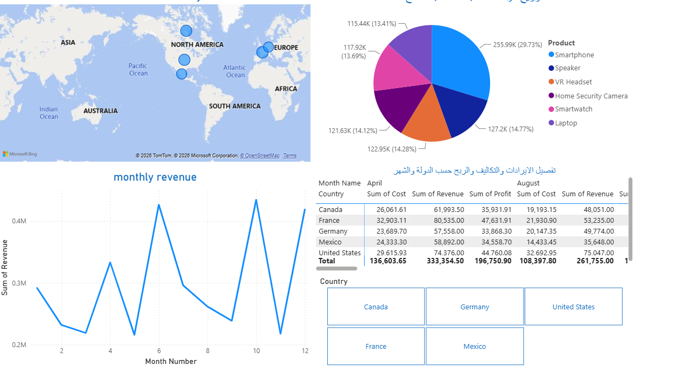

# Retail Financial Analytics & Global Sales Performance Dashboard

An interactive Power BI dashboard that analyzes cost, revenue and profit across countries, months and products.

## Overview

This project gives a clear financial view of retail sales across five markets: the United States, Canada, Mexico, Germany and France. It helps answer questions such as:

- Which countries are the most profitable?
- How does revenue change over the 12 months?
- Which products account for the most units sold?
- How do cost, revenue and profit compare by country and month?

## Dashboard Features

| Visual | What it shows |
| --- | --- |
| Map (Profit over Country) | Profit by country across North America and Europe |
| Pie chart | Units sold by product |
| Line chart (monthly revenue) | Revenue trend across 12 months, with peaks in months 6, 10 and 12 |
| Matrix | Sum of cost, revenue and profit by country and month, with totals |
| Country buttons | One-click filters that update all visuals for the selected market |

## Key Insights

Units sold by product:

- Smartphone: 29.73% (255.99K units), the largest share
- Speaker: 14.77%
- VR Headset: 14.28%
- Home Security Camera: 14.12%
- Smartwatch: 13.69%
- Laptop: 13.41%

## Notes

Some visual titles are written in Arabic, so the dashboard works for both Arabic and English readers.

## Tools

- Microsoft Power BI

## Files

- `dashboard.pbix`: the Power BI project file
- `dashboard-preview.png`: dashboard preview image

## How to Open

Download `dashboard.pbix` and open it with Power BI Desktop (free from Microsoft).
